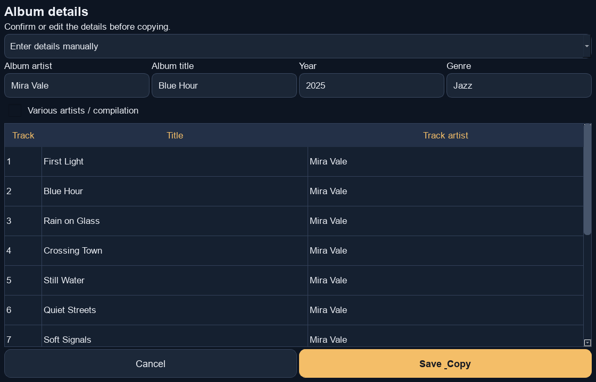
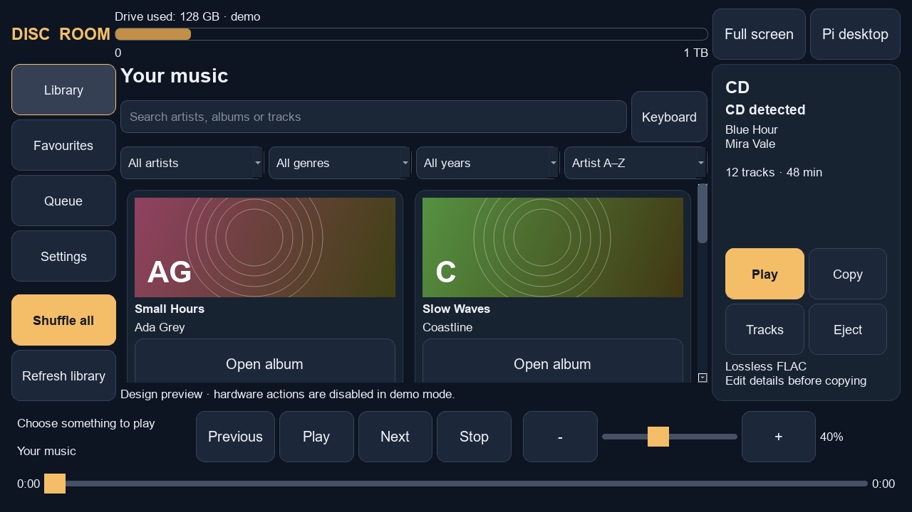
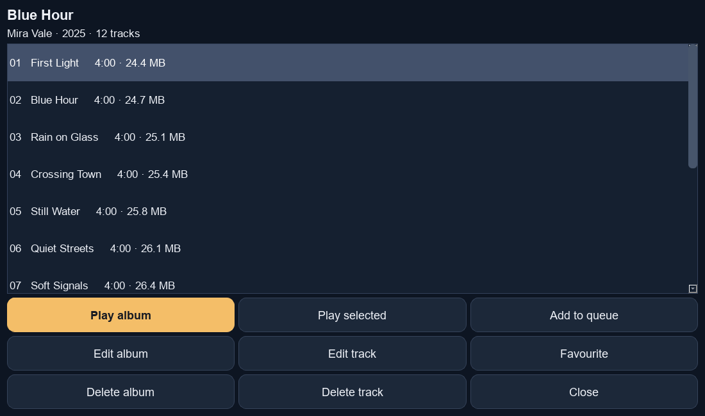
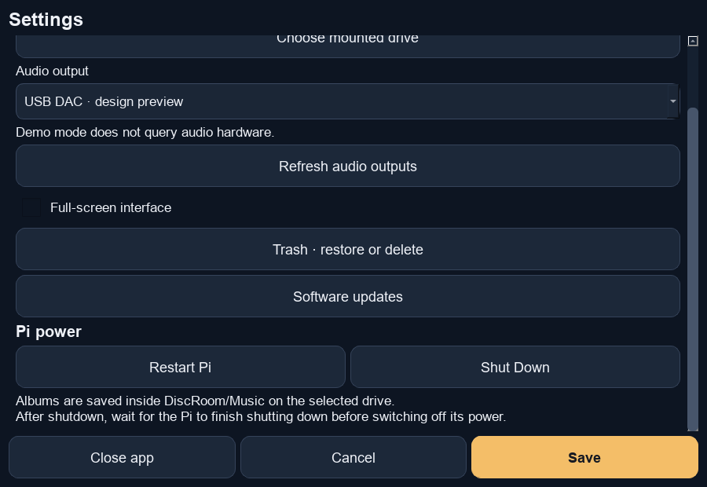

# Disc Room

A touchscreen CD player and FLAC music library for Raspberry Pi. Insert a CD,
choose **Play** or **Copy**, check its album details, and save your music to an
external drive. Browse, search, play and manage your stored albums in one app.

Current app version: **0.3.3**.

## Hardware needed

| Hardware | What to use |
|---|---|
| Raspberry Pi | **Raspberry Pi 4B**. A 4GB model is sufficient for this project. |
| Pi power supply | A suitable Pi 4 USB-C supply, normally 5.1V / 3A. |
| microSD card | 16GB or larger; 32GB is a practical choice for the OS and app. |
| USB CD drive | A Linux-compatible drive that reads audio CDs and supports software eject. A Verbatim USB drive has been tested. |
| Music storage | An external USB HDD/SSD, or a SATA drive with a USB adapter. Use an existing formatted partition with enough free space. |
| Display | An HDMI monitor or compatible Pi touchscreen. The layout targets **1280 × 720 landscape**. A portrait display, such as Touch Display 2, needs landscape rotation. |
| USB DAC and speakers | A Linux-compatible USB audio DAC, plus headphones or an amplifier/powered speakers. A Ugreen USB-to-3.5mm DAC has been tested. |
| USB power | A powered USB hub is recommended when running a CD drive and mechanical HDD together. Power the Pi from its own suitable supply. |
| Network | Ethernet or Wi-Fi for installation, metadata/cover lookup and updates. Stored music can play offline. |
| Setup equipment | A computer and microSD reader for writing the OS. A keyboard/mouse is useful for initial display setup; SSH can handle terminal maintenance. |

**Compatibility:** Raspberry Pi 4B is the tested model. The app may work on other
Raspberry Pis, but they have not been tested. Hardware testing so far used
Raspberry Pi OS **Bookworm / Debian 12**, with 32-bit (`armhf`) applications and
a labwc desktop. Other OS releases/versions and userspace architectures may
work, but have not been tested.

The fresh-install guide below uses **Raspberry Pi OS Lite (Bookworm)** to avoid
installing desktop applications and extra features that are not currently
needed. Lite still needs a small graphics layer to display the touchscreen app.

**The fresh Lite setup below has not yet been verified on a physical Pi.**
The working desktop installation has been tested; it does not need reinstalling.

## 1. Install Raspberry Pi OS Lite

1. On your computer, download [Raspberry Pi Imager](https://www.raspberrypi.com/software/).
2. Insert the microSD card and open Imager. Select **Raspberry Pi 4** as the device.
3. Choose **Raspberry Pi OS Lite — Bookworm / Debian 12**, preferably the 32-bit
   image to match the tested app userspace. If the default image is a newer OS
   release, choose the Bookworm image from Imager's legacy options or use a
   downloaded Bookworm image through **Use custom**.
4. Select the microSD card. Writing an OS image replaces the contents of that
   card, so select the card intended for the Pi's operating system.
5. Configure your own username/password, hostname, Wi-Fi if needed, and locale.
   Enable **SSH** if you want to use your computer for the terminal steps.
6. Write and verify the image. Put the card in the Pi, connect the display and
   hardware, then power it on.

[Watch: How to Install Raspberry Pi OS Lite — StrykerBytes, YouTube](https://www.youtube.com/watch?v=Vok1K50rHwI).

The video uses an older Imager interface. Follow the settings above for your
own username, network and SSH; there is no assumed default Pi login.

For current Imager steps, see the [official installation guide](https://www.raspberrypi.com/documentation/computers/getting-started.html).

Log in on the Pi's attached keyboard/display, or use SSH from your computer:

```sh
ssh YOUR_USERNAME@YOUR_PI_IP
```

Replace both placeholders with your Pi details. On a local Pi terminal,
`hostname -I` shows the IP address. For a headless first boot, find the address
in your router's connected-device list. Use the Pi account password for SSH.

## 2. Update the Pi's OS packages

Run these commands **on the Pi** or in an SSH session connected to it:

```sh
sudo apt update
sudo apt full-upgrade -y
sudo reboot
```

Wait for the Pi to restart, then log in or reconnect through SSH. This updates
packages within the installed OS release; changing to another major OS release
is a separate operation.

## 3. Download and install Disc Room from GitHub

Run as your normal Pi user:

```sh
sudo apt install -y git
git clone --branch v0.3.3 --single-branch https://github.com/danpidan/discroom.git ~/discroom-git
cd ~/discroom-git
bash install.sh
```

The clone downloads the published **v0.3.3** app. The repository is public, so
no GitHub login is needed for downloads or updates. `install.sh` installs the
Python, audio and CD-copying dependencies through apt. It uses sudo for package
installation; the app itself runs as your ordinary user.

If `~/discroom-git` already exists, use that installation instead of cloning over
it. Existing users should use the update button described below.

## 4. Set up Lite's display, music drive and automatic startup

Complete the numbered steps in [OS-LITE.md](docs/OS-LITE.md). They install a
minimal X11/Openbox session, mount your existing music partition by its UUID,
and configure automatic full-screen startup through `launch.py`.

This step is required on Lite: installing Python dependencies alone does not
create a graphical session. The setup runs the app without the full Raspberry
Pi desktop, browser or office applications. It does not use File Manager to
mount the HDD and has no desktop CD-insertion popup.

After completing the setup, reboot with the display, CD drive, DAC and music
drive connected. The app should open on the Pi's attached screen. Boot messages
may still be visible before the graphical session starts.

If you already use the working labwc desktop installation, keep that startup
setup and skip the Lite conversion. See [DEVELOPMENT.md](DEVELOPMENT.md) for
remote development and troubleshooting release publishing.

## 5. Configure the app the first time

1. Open **Settings**.
2. For **Music drive mount folder**, select `/mnt/discroom-music` if you followed
   the Lite storage guide. Select the mount folder, rather than its Music subfolder.
   A desktop installation can instead select its existing `/media/...` mount.
3. Under **Audio output**, choose the detected output describing your USB DAC.
   Use **Refresh audio outputs** after connecting a DAC if necessary.
4. Press **Save**.
5. If albums are already in `DiscRoom/Music` on that drive, they will appear.
   Otherwise, insert an audio CD and copy your first album.

Settings are saved in `~/.config/discroom/config.json`. Music uses this layout
inside the selected mounted drive:

```text
DiscRoom/Music/Album artist/Album title/Disc 1/01 - Track title.flac
```

The app creates its dedicated folder and manages music inside it. Changing the
selected drive does not move music from another drive. Albums refresh when the
music drive becomes available, normally within five seconds plus scan time.

## How to use Disc Room

The screenshots below show the actual Qt app in demo mode, using fictional
albums and tracks. They are software screenshots rather than photos of a Pi.

### Play a CD

1. Insert an audio CD and wait for the app to detect it.
2. Choose **Play** in the CD panel.
3. Use **Tracks** to choose a track, and the player controls to pause, navigate
   and adjust volume. Use **Eject** when finished.

Direct CD playback needs an mpv build with CDDA support. Copying and stored FLAC
playback are hardware-verified; direct CD playback needs its own hardware check.

### Copy a CD to your library

1. Insert an audio CD and choose **Copy**.
2. Review the album artist, title, year, genre and every track title. Internet
   lookup can return the wrong edition or no match; edit any incorrect details.
   You can enter details manually when offline or when no match is found.
3. For compilations, use **Various artists / compilation** and check each
   track's artist.
4. Press **Save & Copy**. The app shows progress while extracting and saving
   lossless FLAC tracks, with encoding verification.
5. When saving finishes successfully, the album appears and the CD ejects.

**Check album and track details before copying:**



Use **Cancel copy** if needed and wait for cancellation to finish. A cancelled
or failed copy is not published as a completed album. To copy a second edition
of an already stored album/disc, give it a distinct album title.

### Find and play stored music

- Type an artist, album or track title into **Search**. **Keyboard** opens the
  app's touchscreen keyboard.
- Use artist, genre and year filters, sorting, or **Favourites** to narrow the list.
- Open an album and press **Play album**, or select a track and press **Play selected**.
- **Add to queue** adds the album to the playback queue.
- Use **Previous**, **Play/Pause**, **Next**, **Stop** and the seek slider.
- Adjust volume with the slider or **− / +** buttons. The app remembers the level.

**Library, search, filters and playback controls** — the CD panel on the right
also contains **Play**, **Copy**, **Tracks** and **Eject**:



### Edit or delete music

Open an album to use **Edit album**, **Edit track**, **Delete album** or
**Delete track**. Select a track before using its individual controls.

**Album screen** — select a track, then choose its playback or management action:



Edits change tags and refresh the display; stored file paths remain as they are.
Deletion moves music to the app's Trash. Open **Settings → Trash** to **Restore**
it or **Delete permanently** to free disk space. Restoring refuses to overwrite
newer music already occupying the destination.

### Restart or shut down

Open **Settings → Restart Pi** or **Shut Down**, then confirm. Finish CD copying
and music edits first. Wait for shutdown to finish before disconnecting power.
On Pi 4B, switch the supply off, wait about five seconds and switch it on again
to start after shutdown. A restart should reopen Disc Room automatically.

**Settings, scrolled to the Pi power controls:**



**Close app** exits only the application. In the Lite/Openbox setup, the minimal
graphical session stays open; use SSH or its terminal for maintenance.

## Update the app from GitHub

1. Finish any CD copy or library edit and make sure the Pi has internet access.
2. Open **Settings → Software updates** (shown in the Settings screenshot above).
3. The repository URL should be `https://github.com/danpidan/discroom.git`.
4. Press **Check for updates**.
5. If a newer version is available, press **Update app**.
6. Wait while the release is downloaded and checked. The app restarts automatically.
7. Open Software updates again to confirm the **Running version**.

Downloads need no GitHub login. Music and settings are stored separately from
app releases. If a newly installed release fails to start, the launcher attempts
the previous version. **Roll back update** selects a previous version for other
problems; it rolls back app code, rather than music edits or settings history.

For maintainers, the release tag must match `VERSION` in that release's
`core.py`: `v0.3.3` must contain `VERSION = "0.3.3"`. Upload/commit the code first,
then create the matching new tag. Do not rewrite published tags. Publishing
requires your GitHub account; see [DEVELOPMENT.md](DEVELOPMENT.md).

## Troubleshooting and limits

- **Music drive disconnected:** check cables/power and `findmnt /mnt/discroom-music`.
  The app requires a mounted, writable external music folder.
- **No sound:** check the DAC connection, select its detected output in Settings,
  and check your amplifier/headphones and software volume. Close other players
  that may hold the DAC. `mpv --audio-device=help` lists detected outputs.
- **GUI does not start on Lite:** see the display/startup checks in
  [OS-LITE.md](docs/OS-LITE.md). An ordinary SSH shell has no graphical display.
- **Release version mismatch:** the published tag and its `core.py` version must
  agree. Editing a release title does not change its tag or commit.
- Scratched discs can fail. FLAC verification checks encoding against the
  extracted audio; AccurateRip comparison is not implemented.
- Boot splash, network sharing through Samba and saved playlist management are
  not configured by this package. Music is stored locally on the selected drive.

For a preview without hardware access, run `python3 discroom.py --demo` in a
graphical session. With the screenshot tool available, `python3 tools/screenshots.py`
regenerates the demo images using an offscreen display. App dependency installation
is required. Hardware-free checks run with `python3 -m unittest discover -v`.